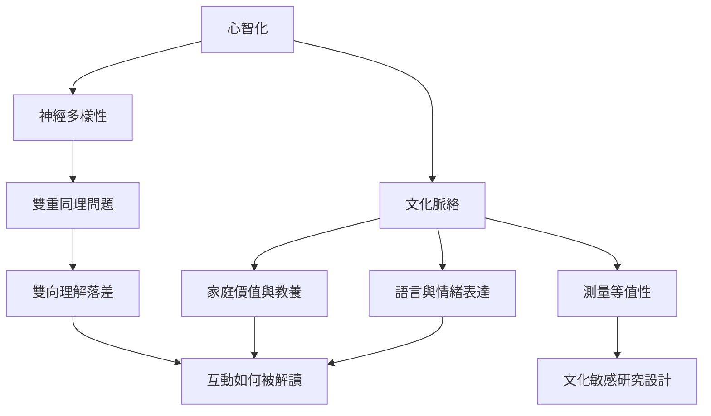

本地圖把心智化放入文化與神經多樣性視角。重點不是把某種文化或神經類型排出能力高低，而是追問：心理狀態如何被表達、測量工具如何定義常模、互動困難由哪些雙方與環境條件共同形成。

## 思與行
* 在地化不只翻譯量表，也需要重新檢視構念與社會規範。
* 讓被研究社群共同參與定義問題與解讀結果。

## 參考
* [[跨文化回顧指出心智化表現會受語言價值與教養脈絡影響]]、[[自閉症雙重同理問題提醒研究者不要把互動困難單向歸因於個體缺陷]]、[[台灣華人特殊健康照護需求家庭的父母反思功能需要文化調整]]。
* 概念：[[神經多樣性]]、[[雙重同理問題]]、[[文化塑造心智化表達而不必然決定心智化能力]]。
