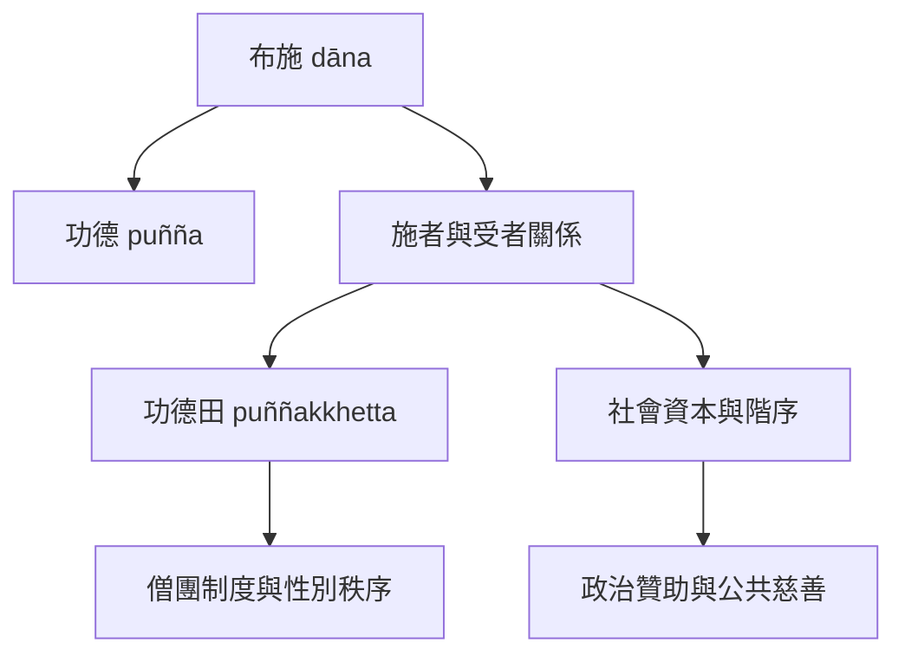

這張概念地圖將布施、功德田與社群權力放在同一張圖上。布施具有倫理意義，也會建構僧俗互動、社會聲望與制度資源。

概念：[[布施 dāna]]、[[功德 puñña]]、[[功德田 puññakkhetta]]。

文獻：[[僧團作為福田的經典論述同時包含布施倫理與制度觀]]、[[泰國慈善布施是階級關係協商而非單純交換]]、[[泰國女性苦行者透過修道建立功德場域與宗教能動性]]、[[柬埔寨寺院的功德活動受到政治贊助與地方社群理想牽動]]、[[緬甸與南傳佛教世界的儀式布施是文化媒介]]。

永久筆記：[[功德田的制度安排決定哪些人被視為值得供養]]、[[功德實踐同時生產社群連結與社會階序]]。

參考：[[Merit_(Buddhism)]]。
