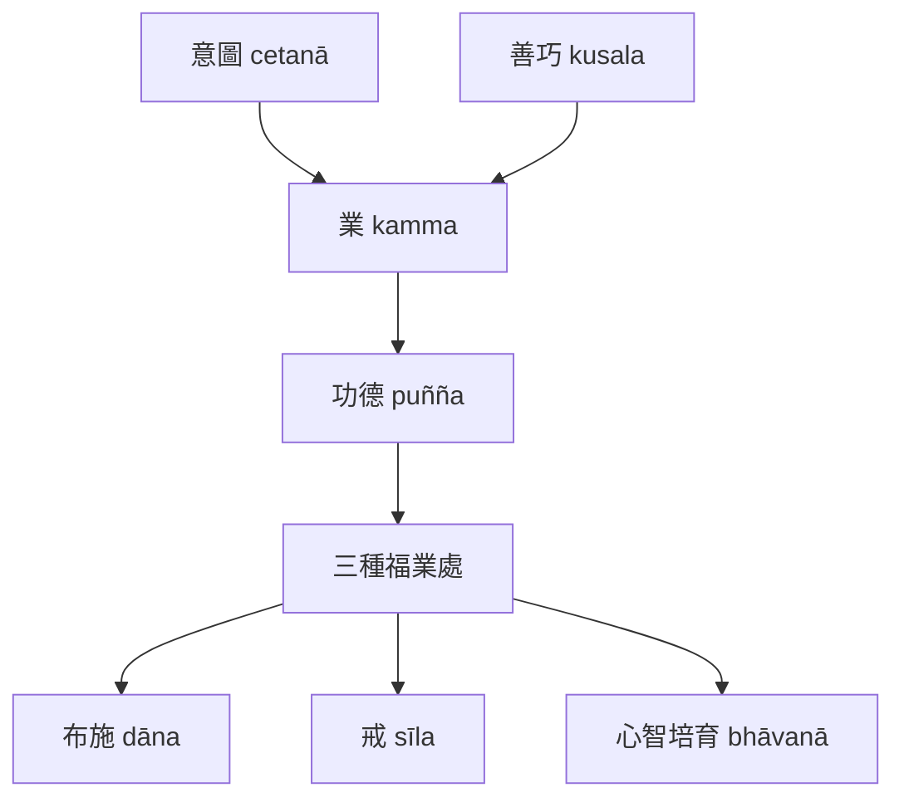

這張概念地圖整理功德、業、意圖與三福業處之間的關係。早期佛典同時呈現行為的因果面向與日常修行的多種形式，閱讀時應避免將功德直接等同捐款或業報。

概念：[[功德 puñña]]、[[puñña]]、[[puṇya]]、[[善巧 kusala]]、[[業 kamma]]、[[意圖 cetanā]]、[[三種福業處 puññakiriyavatthu]]、[[布施 dāna]]、[[戒 sīla]]、[[心智培育 bhāvanā]]。

文獻：[[三種福德行把布施戒行與心智培育放在同一修行框架]]、[[業的核心是意圖而非單純外在捐獻]]、[[巴利經典以持續行善而非一次性累積描述福德]]。

永久筆記：[[功德與善業相關但不能直接視為同義詞]]、[[三種福業處使功德不被縮減為捐款]]、[[功德的品質取決於意圖也受到行動後果檢驗]]。

參考：[[Merit_(Buddhism)]]。
