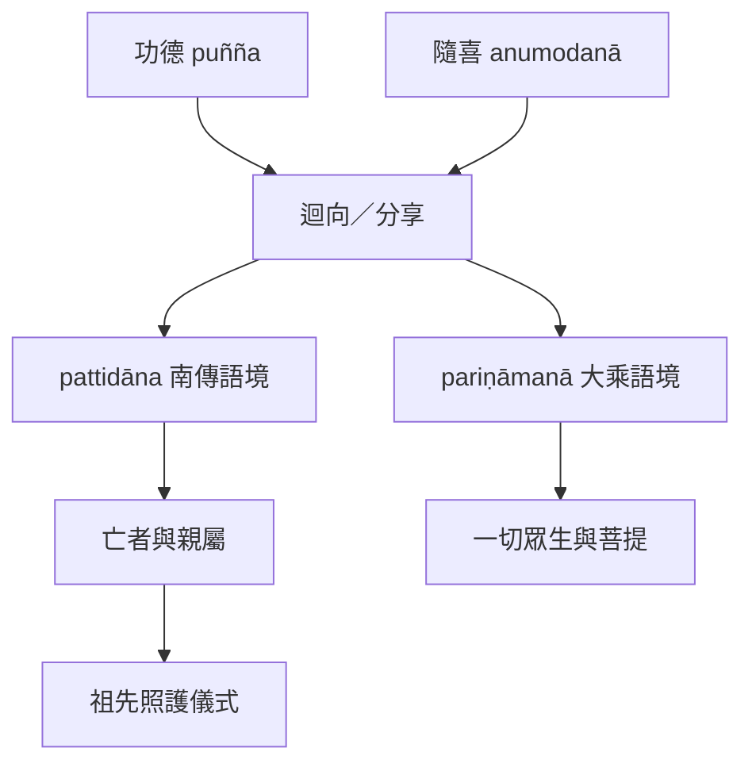

這張概念地圖比較南傳功德分享與大乘普遍迴向的語彙及實踐。兩者都涉及善行利益如何指向他者，但術語來源、受益對象與教義說明不能混為一談。

概念：[[功德 puñña]]、[[功德迴向 pattidāna]]、[[迴向 pariṇāmanā]]、[[隨喜 anumodanā]]。

文獻：[[迴向亡者的經典基礎呈現於戶外經]]、[[大乘普賢行願把隨喜與普遍迴向納入菩薩實踐]]、[[中國佛教的功德迴向與祖先倫理交織成多層實踐]]、[[日本佛教的葬儀與追善法會構成持續的祖先照護]]。

永久筆記：[[功德迴向在不同傳統中不是單一固定的轉移機制]]、[[隨喜使他人的善行成為自己的修行契機]]、[[功德迴向與祖先照護把修行延伸到生死關係]]。

參考：[[Merit_(Buddhism)]]。
