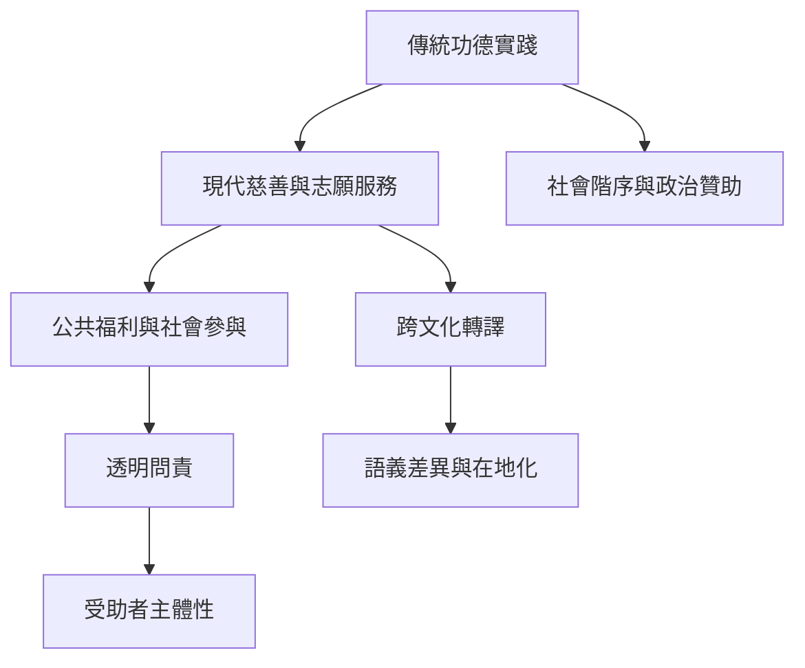

這張概念地圖整理功德如何在現代社會轉化為慈善、志願服務、公共教育與跨文化對話，同時提醒我們持續檢查權力關係與受助者主體性。

概念：[[功德 puñña]]、[[布施 dāna]]、[[善巧 kusala]]。

文獻：[[台灣慈濟以現代慈善重構布施傳統]]、[[澳大利亞南天寺顯示功德可透過服務與志願行動跨文化呈現]]、[[泰國佛教功德觀與王權政治的關係有長期歷史脈絡]]。

永久筆記：[[現代慈善把福德轉譯成志願服務與公共福利]]、[[功德的現代轉譯需要保留受助者的主體性]]、[[功德概念的研究必須區分經典規範儀式實作與參與者經驗]]。

靈感：[[讓公益組織的功德敘事接受透明與問責檢驗]]、[[建立全球功德田野筆記以比較不同社會中的給予關係]]。

參考：[[Merit_(Buddhism)]]。
