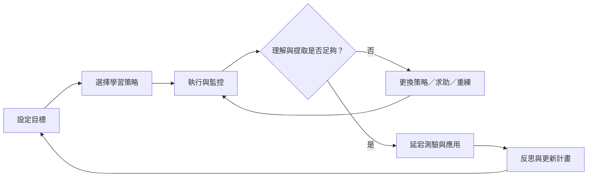

學習中的後設認知必須落在策略與結果上。計畫階段設定目標，執行階段監控理解與時間，評估階段用提取與延宕測驗檢查成果，再修訂下一輪策略。

## Mermaid 關係圖

## 延伸閱讀
[[自我調節學習]]、[[學習策略]]、[[提取練習]]、[[分散練習]]、[[後設認知是一個包含計畫監控評估的循環]]、[[後設認知調節受到動機情緒與環境共同影響]]、[[教學設計應把思考過程外顯成可練習的步驟]]
