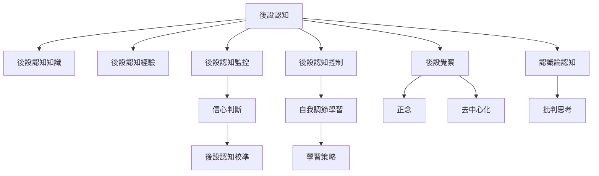

後設認知的核心不是「想更多」，而是對認知狀態形成可用的估計，並依照目標和回饋調整行動。這張地圖先分辨知識、經驗、監控、控制，再連到學習、自我調節、信心校準、文化與正念等支線。

## Mermaid 關係圖

## 延伸閱讀
[[後設認知]]、[[後設認知監控]]、[[後設認知控制]]、[[後設認知知識]]、[[後設認知經驗]]、[[信心判斷]]、[[後設認知校準]]、[[自我調節學習]]、[[學習策略]]、[[後設覺察]]、[[正念]]、[[去中心化]]、[[認識論認知]]、[[批判思考]]
