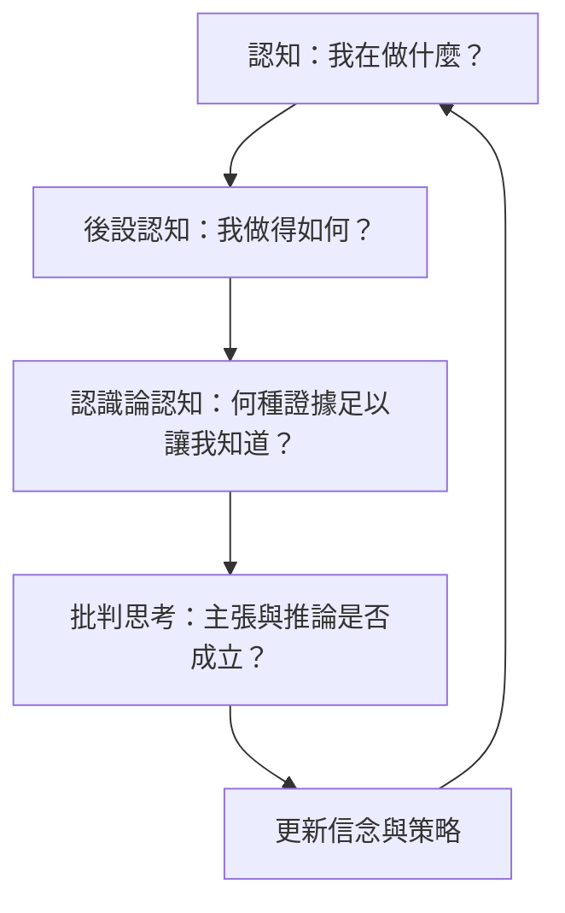

由認知到後設認知，再到認識論認知，可以理解成問題層次逐步提高：先處理任務，再檢查自己是否理解，最後追問證據、知識與確定性的標準。這不是嚴格的階級，而是不同焦點的分析層次。

## Mermaid 關係圖

## 延伸閱讀
[[認識論認知]]、[[批判思考]]、[[後設認知]]、[[信心判斷]]、[[不確定性]]、[[認知後設認知與認識論認知處理不同層次的問題]]、[[後設認知與批判思考相互支持但不可混為一談]]
