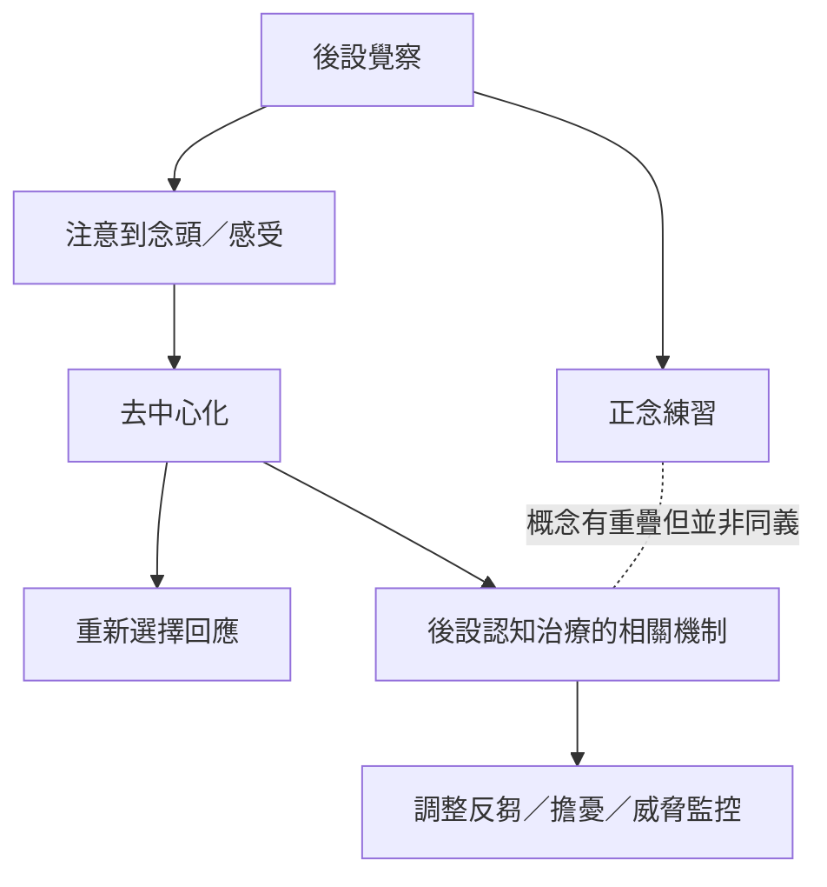

後設覺察、正念與臨床後設認知治療有交集，但不宜混為同一套理論。共同問題是：人如何注意到念頭與情緒正在發生，以及如何改變對它們的反應。正念研究強調覺察品質，MCT 則有特定臨床模型、維持機制與治療流程。

## Mermaid 關係圖

## 延伸閱讀
[[後設覺察]]、[[正念]]、[[去中心化]]、[[後設認知治療]]、[[後設覺察與後設認知有重疊但不完全相同]]、[[正念中的後設覺察能讓念頭被看見而不必被相信]]
