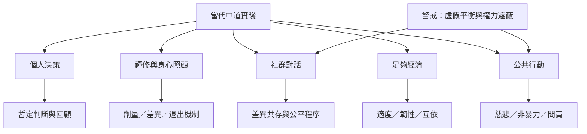

中道可用於個人決策、禪修安排、社群治理、經濟生活與公共行動，但必須同時防範三種誤用：把它簡化成折衷、把它當成道德優越感、把它用來掩蓋權力差距。當代研究也提醒，正念介入效果可能受劑量與條件影響；經濟實踐則需要兼顧個人、社群與環境。

## 關聯筆記
* [[note/正念與禪修的效果需要考慮劑量與個體差異]]
* [[note/當代中道哲學把暫定判斷當作反絕對化的練習]]
* [[note/中道經濟需要同時衡量足夠自立互依與生態]]
* [[note/中道不能被用來要求受害者與加害者各退一步]]
* [[note/中道可以連結個人修行與公共照顧]]

## 延伸行動
* [[idea/建立個人化的中道決策日誌]]
* [[idea/建立可調整且可退出的禪修節奏]]
* [[idea/設計不以平均退讓為預設的衝突對話流程]]
* [[idea/用中道檢查生活消費與足夠經濟]]。

[[Middle_Way]]
