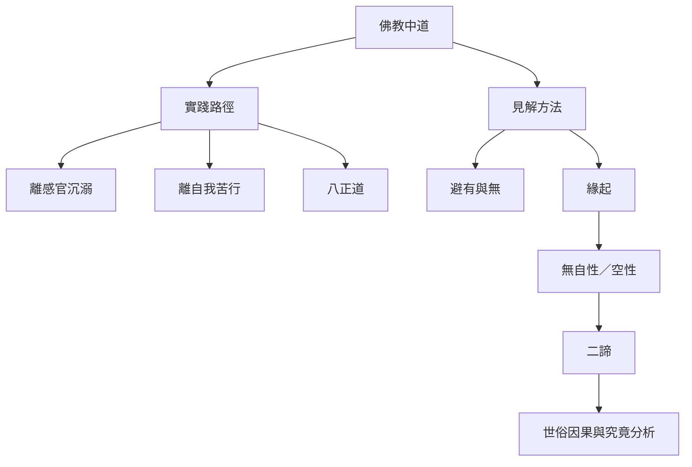

佛教中道至少有兩條互相支援、但不可混淆的主線。實踐上的中道，從避免感官放縱與自我苦行出發，以八正道為完整路徑；見解上的中道，從避免有與無、常與斷的極端出發，以緣起與無自性鬆動對固定實體的執取。後來中觀將後者發展成系統哲學，並以二諦說明世俗有效性與究竟分析的互依。

閱讀路徑：先讀 [[data/初轉法輪經說明中道是通往止息苦的八正道]] 與 [[data/迦旃延氏經以緣起避開存在與不存在的二邊]]，再讀 [[data/龍樹以緣起性空重新界定中道]]、[[data/中觀思想以二諦連接日常語言與究竟分析]]。

## 關聯筆記
* [[note/佛教中道首先要求檢查感官追逐與自我懲罰]]
* [[note/八正道把中道轉化為可實踐的整體訓練]]
* [[note/緣起讓有與無不再是唯一的理解選項]]
* [[note/空性不是虛無而是對自性執的校正]]
* [[note/二諦不是兩個互不相干的世界]]
* [[note/中道的意義會隨經典與宗派脈絡改變]]

## 概念連結
* [[term/Middle_Way_Concept]]、[[term/Majjhima_Patipada]]、[[term/Madhyamaka]]
* [[term/Noble_Eightfold_Path]]、[[term/Dependent_Origination]]、[[term/Emptiness]]、[[term/Two_Truths]]。

[[Middle_Way]]
