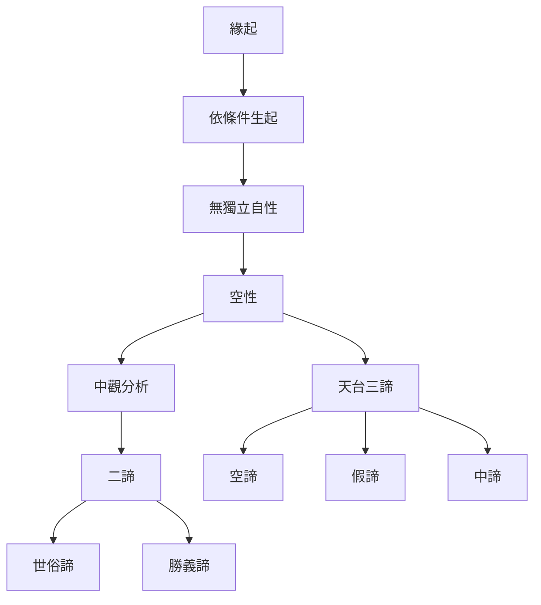

本圖整理大乘佛教中觀與天台思想如何處理現象的依存性。緣起說明事物依條件成立；空性指出其不具獨立自性；二諦區分世俗運作與究竟分析；天台三諦則以空、假、中同時觀照諸法。這些概念彼此相關，但各自形成於不同文本與哲學脈絡。

## 關聯筆記
* [[note/緣起讓有與無不再是唯一的理解選項]]
* [[note/空性不是虛無而是對自性執的校正]]
* [[note/二諦不是兩個互不相干的世界]]
* [[note/中觀以反實體化拆解固著的概念]]
* [[note/中道的意義會隨經典與宗派脈絡改變]]

## 概念連結
* [[term/Dependent_Origination]]、[[term/Emptiness]]、[[term/Two_Truths]]、[[term/Three_Truths]]、[[term/Madhyamaka]]。

[[Middle_Way]]
