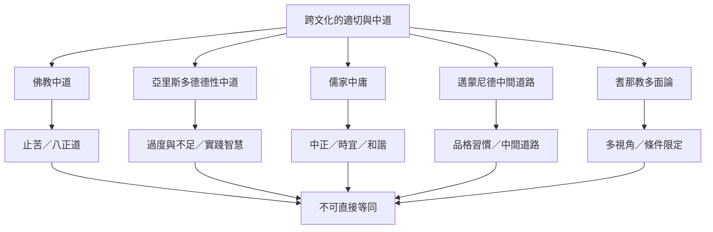

全球思想傳統對「適切」「兩端」「節度」發展出不同回答。佛教中道以止苦與離二邊為核心；亞里斯多德以德性與實踐智慧判斷適中；儒家中庸把情感節度放在關係與時宜中；邁蒙尼德以中間道路培養性格；耆那教多面論則提醒任何觀點都受視角限制。它們可互相對話，但不是同一套學說。

## 關聯筆記
* [[note/中道不是兩端的算術平均而是依條件調整的實踐道路]]
* [[note/德性中道是依人與情境判斷的適切而非平均]]
* [[note/中庸的適切性建立在關係與時機而非機械折衷]]
* [[note/多面性認識論提醒單一觀點不會窮盡事物]]
* [[note/跨文化比較應保留概念之間的不可化約差異]]

## 概念連結
* [[term/Middle_Way_Concept]]、[[term/Aristotelian_Mean]]、[[term/Zhongyong]]、[[term/Anekantavada]]。

[[Middle_Way]]
