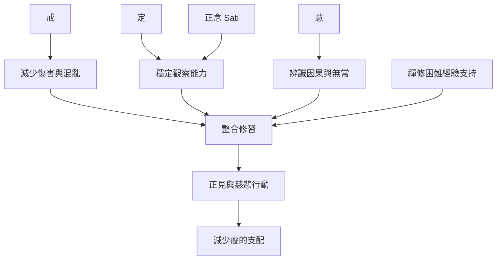

對治癡並非只增加資訊或壓制念頭，而是讓倫理生活、穩定注意與智慧辨識共同運作。正見與四聖諦提供方向，正念帶來觀察，戒定慧則讓觀察轉化成更少傷害的行動。現代禪修社群也需要把安全、功能與倫理納入修行評估。

## 概念連結
* [[正見（Sammā-diṭṭhi）]]、[[正念（Sati）]]、[[慧（Paññā／Prajñā）]]、[[如理作意（Yoniso Manasikāra）]]
* [[平等心不是無感或對事實冷漠]]、[[去除癡需要戒定慧整合而不能只依靠專注]]、[[智慧應以減少傷害與增進辨識來檢驗]]
* [[為禪修社群建立不浪漫化困難經驗的支持機制]]

## 核心文獻
* [[阿姜查提醒定力必須與智慧共同發展]]、[[當代佛教心理學仍需超越正念單一框架]]、[[2025年冥想研究提醒勿把不尋常信念浪漫化]]
