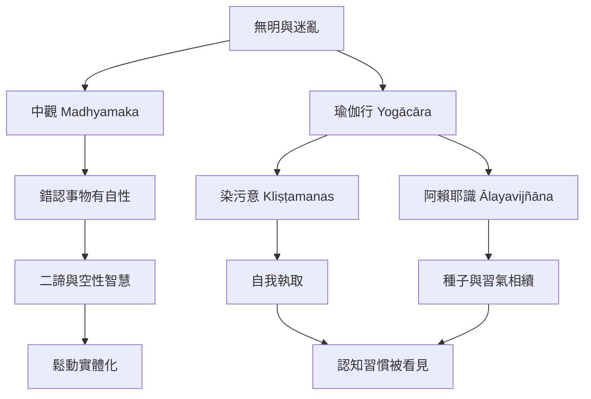

大乘與藏傳材料不只沿用三毒分類，也發展關於無明如何構成錯誤認知的哲學模型。中觀聚焦把依存現象誤認為自性成立；瑜伽行派透過染污意、阿賴耶識與三性分析經驗的建構與自我執取。兩種路徑可互相對話，但不應被混成同一套理論。

## 概念連結
* [[中觀（Madhyamaka）]]、[[空性（Śūnyatā）]]、[[二諦（Dve Satya）]]
* [[瑜伽行派（Yogācāra）]]、[[染污意（Kliṣṭamanas）]]、[[阿賴耶識（Ālayavijñāna）]]
* [[中觀把無明理解為將依存事物實體化]]、[[瑜伽行派讓迷亂成為可分析的認知過程]]

## 核心文獻
* [[宗喀巴將根本無明分析為投射自性]]、[[瑜伽行派以染污意與識的結構分析認知迷亂]]、[[佛教知識論依不同傳統發展出多種求知路徑]]、[[大智度論的三毒討論顯示大乘詮釋脈絡]]
