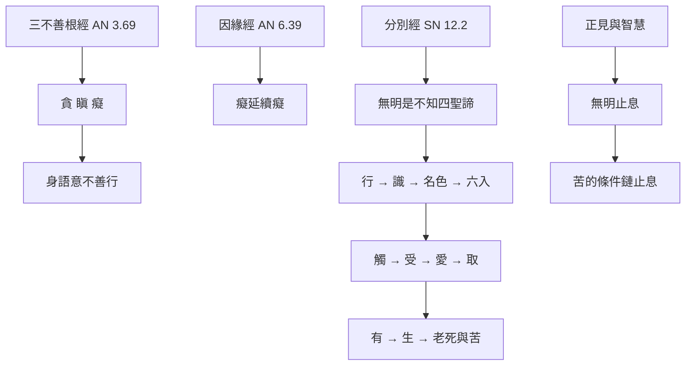

早期佛教材料至少提供兩條互補的分析線索：一是把貪、瞋、癡視為不善行動的根源；二是把無明界定為不知四聖諦，並置入緣起鏈。前者偏重倫理行動的根源，後者偏重苦如何生起與止息。

## 概念連結
* [[緣起（Paṭiccasamuppāda）]]、[[四聖諦（Cattāri Ariyasaccāni）]]、[[十二因緣（Twelve Nidānas）]]、[[正見（Sammā-diṭṭhi）]]
* [[無明要在四聖諦與緣起中理解]]、[[癡常與貪瞋共生而形成回饋循環]]、[[承認不知道是智慧的起點而不是缺陷]]

## 核心文獻
* [[三不善根經把癡列為不善行為的根源]]、[[癡不能自行生出智慧而會延續自身]]、[[緣起經以四聖諦的不知界定無明]]、[[伊提弗多迦經把癡描寫為內在敵人]]
