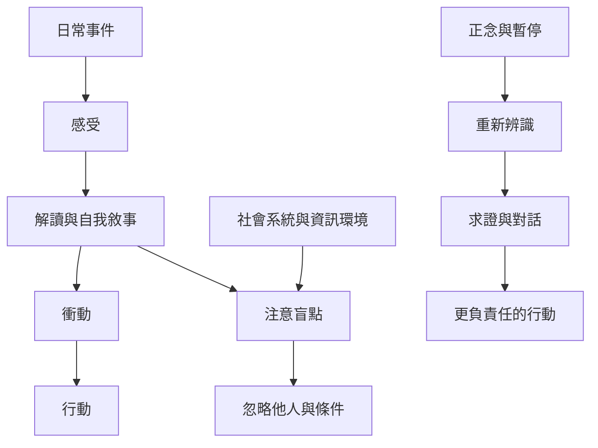

把癡放進日常生活，最實用的入口是觀察「感受—解讀—衝動—行動」之間的快速連結，再追問個人視角如何受到群體、制度與資訊環境影響。跨領域借用必須標示為類比：佛教的癡不是認知偏誤、演算法偏差或社會不平等的同義詞，但可作為對照的思想資源。

## 概念連結
* [[用感受到行動的五段記錄觀察癡如何介入]]、[[每日練習標記知道推測未知與待查證]]、[[在日常對話中練習暫緩判斷與重述理解]]
* [[用正見檢查媒體資訊與演算法造成的迷霧]]、[[將癡與社會生態學連結以檢查集體盲點]]、[[以互賴視角看見認知盲點背後的條件]]
* [[癡會遮蔽事物並扭曲注意與辨識]]、[[無知有時以冷漠與忽略的樣貌出現]]

## 核心文獻
* [[印藏佛教倫理以三毒說明吸引排斥與忽略]]、[[2025年冥想研究提醒勿把不尋常信念浪漫化]]、[[佛教認識論能與西方哲學對話但不可混同]]
