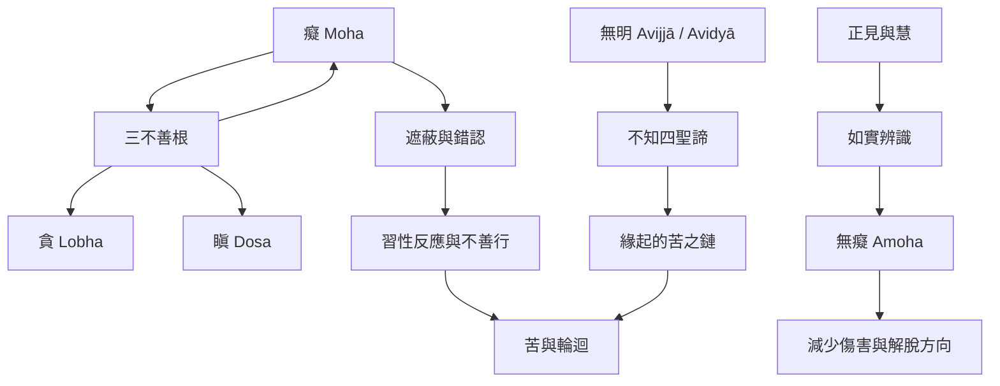

本圖將研究主題分成三個相互銜接的層次：術語、心理運作、倫理與解脫。癡（moha）是三不善根／三毒之一；無明（avijjā／avidyā）在不同文本中與癡重疊，但各自的語境需要分辨。研究主線從錯誤把握，延伸到三毒互動，再連到智慧與行動。

## 概念連結
* [[癡（Moha）]]、[[無明（Avijjā／Avidyā）]]、[[三毒（Triviṣa）]]、[[三不善根（Akusala-mūla）]]
* [[癡不是知識不足而是對經驗的錯誤把握]]、[[癡會遮蔽事物並扭曲注意與辨識]]、[[無明與癡在部分文獻中重疊但不宜不加區分]]
* [[慧（Paññā／Prajñā）]]、[[無癡（Amoha）]]、[[慧（Paññā／Prajñā）]]

## 進一步閱讀
* [[三不善根經把癡列為不善行為的根源]]、[[緣起經以四聖諦的不知界定無明]]、[[佛光大辭典界定癡為不辨事理的三不善根]]
