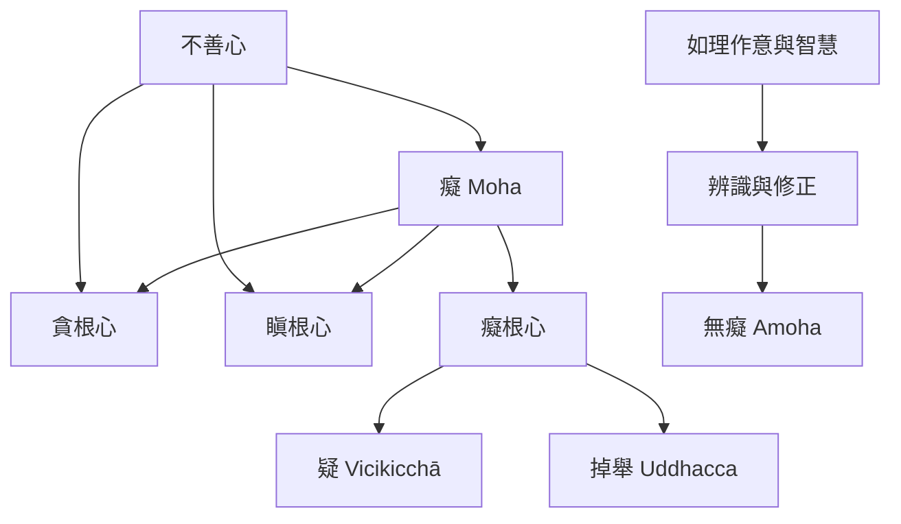

上座部阿毘達磨將心識活動分解為心與心所，並指出癡與不善心俱起。這個視角可以把迷惑拆成遮蔽、疑與散亂等不同表現，幫助研究者從單一抽象詞走向可觀察的心智過程。

## 概念連結
* [[癡（Moha）]]、[[疑（Vicikicchā）]]、[[掉舉（Uddhacca）]]、[[無癡（Amoha）]]、[[慧（Paññā／Prajñā）]]
* [[阿毘達磨把癡視為不善心的底層條件]]、[[疑與掉舉可能是癡特別顯著的心識表現]]、[[智慧不是清空念頭而是看清念頭如何形成]]

## 核心文獻
* [[阿毘達磨將癡分析為不善心的共同根]]、[[上座部心識模型把癡置於心所分析中心]]、[[當代佛教心理學仍需超越正念單一框架]]
