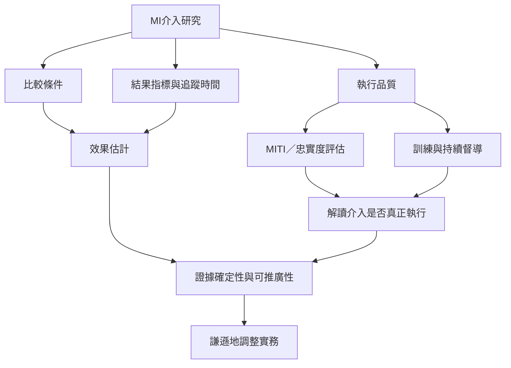

MI 的效果並非在所有領域、所有比較組和所有追蹤時間都相同。研究品質地圖要把介入結果、研究確定性、比較條件、執行忠實度和技能維持放在一起看。量表與統合分析提供可檢查的證據，但不能自動替代情境判斷。

核心永久筆記：[[MI的效果必須依比較組與結果指標判讀]]、[[MI成效研究必須檢查執行忠實度]]、[[MI能力需要練習回饋而非一次性上課]]。

## 思與行
* 閱讀任何 MI 研究時，至少同時記錄效果估計、比較組、追蹤長度、忠實度與證據確定性。
* 將評估工具用於回饋和改善，不用來對個別工作者或服務使用者貼標籤。

## 參考
* [[物質使用領域的MI效果取決於比較對象且整體證據並非壓倒性]]；[[納入MI的身體活動介入有整體效果但難以分離MI本身的貢獻]]；[[2025年的批判指出MI定義演變與執行品質不足仍待處理]]。

回到專書導讀：[[Motivational_interviewing]]
