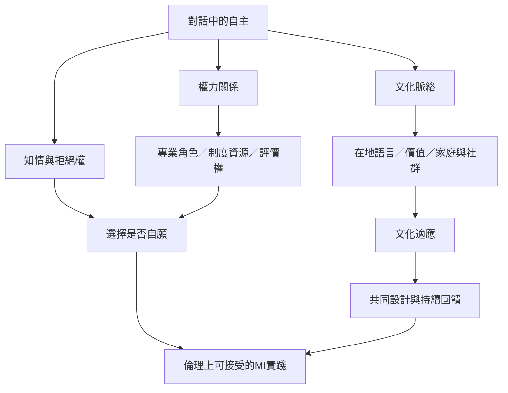

MI 強調自主，但自主不是脫離關係與制度的個人能力。文化價值、語言、權力差距、拒絕成本與服務可近性都會影響選擇是否真實。文化適應不能只翻譯手冊，制度場域也必須說清楚規範與自願選擇的差異。

核心永久筆記：[[自主支持要求助人者放下替別人決定的衝動]]、[[文化適應不是逐字翻譯而是共同建構脈絡]]、[[制度場域的MI必須保障參與者的拒絕權]]、[[MI應支持選擇而非取代專業照護]]。

## 思與行
* 在使用 MI 前先盤點拒絕的實際代價，而非只確認表面上是否取得同意。
* 讓服務使用者參與設計與評估，確認自己的語言和價值是否被尊重。

## 參考
* [[文化適應研究顯示MI需要調整情境內容與概念語彙]]；[[學校場域的MI研究顯示平均效果小且受介入劑量影響]]。

回到專書導讀：[[Motivational_interviewing]]
