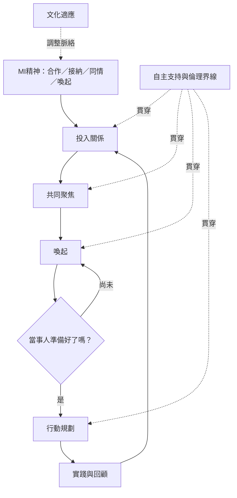

這張概念地圖整理 MI 的倫理與流程基礎：先建立投入關係，再共同聚焦，透過喚起探索當事人自己的改變與維持現狀理由，並在準備好時進入行動規劃。整個流程受到 MI 精神、文化脈絡與自主支持貫穿，不是線性腳本。

核心永久筆記：[[MI的精神比話術清單更重要]]、[[MI的四項任務是可往返的對話導航]]、[[自主支持要求助人者放下替別人決定的衝動]]、[[文化適應不是逐字翻譯而是共同建構脈絡]]。

## 思與行
* 用這張圖檢查自己是否過早從關係跳到規劃。
* 在每個任務中都詢問：誰決定目標？誰掌握資訊？對方能否拒絕？

## 參考
* [[MI第四版以投入聚焦喚起規劃統整整段改變歷程]]；[[MI的精神比話術清單更重要]]。

回到專書導讀：[[Motivational_interviewing]]
