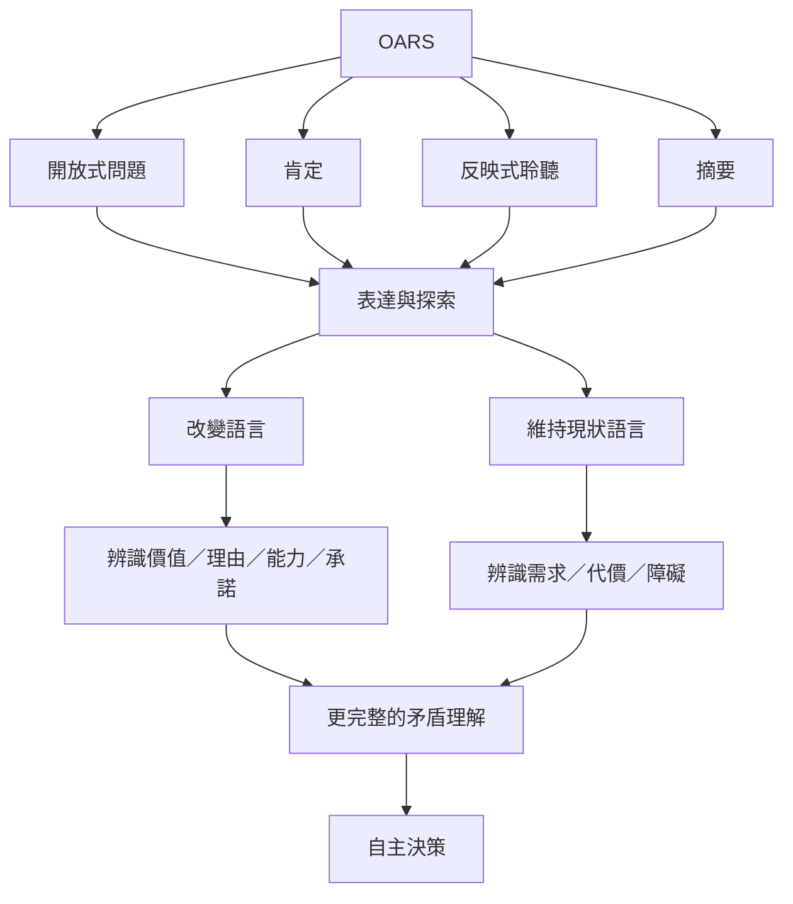

本圖把 OARS 的傾聽技能與當事人的兩類語言連在一起。助人者透過開放式問題、肯定、反映與摘要創造表達空間；change talk 與 sustain talk 都是理解矛盾心理的材料。對話重點不是讓改變語言數量最大化，而是讓當事人更清楚自己的價值、需求與選擇。

核心永久筆記：[[OARS讓傾聽具體化但不應變成機械式問答]]、[[改變語言是探索材料而不是服從程度的測量]]、[[維持現狀語言揭露了改變的代價與需求]]、[[矛盾心理是多種需要同時存在的訊號]]。

## 思與行
* 練習時同時標記自己做了哪些 OARS 行為，以及是否給予 sustain talk 合理空間。
* 避免用 change talk 數量當作對話品質的唯一指標。

## 參考
* [[MI歷程統合分析支持部分技術路徑但不支持簡化的改變語言神話]]；[[MI以接納與同理探索矛盾而不是以說服壓過矛盾]]。

回到專書導讀：[[Motivational_interviewing]]
