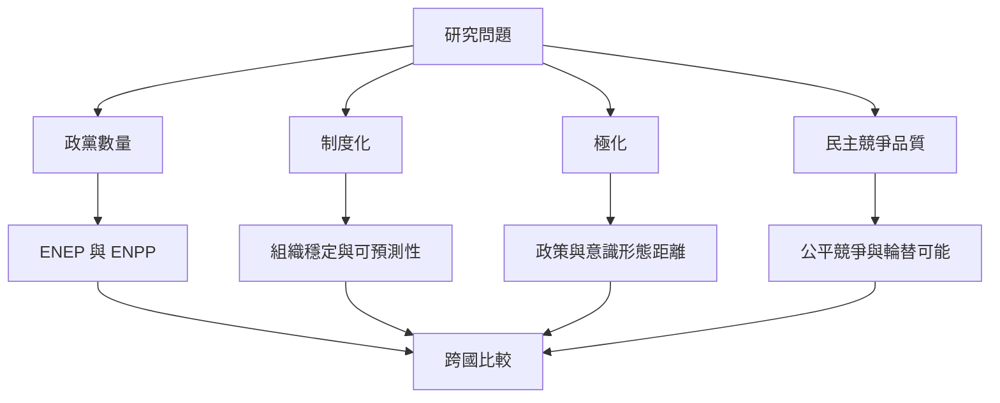

研究多黨制度時，先界定研究問題，再選擇指標。數量指標回答政黨分布是否集中；制度化指標回答競爭是否穩定；極化指標回答立場距離；民主品質與選舉公平指標則回答政治競爭是否具有實質意義。這些變數彼此關聯，但不能互相取代。

研究者可結合官方選舉結果、International IDEA、V-Dem 與學術資料集。[[建立跨國政黨體系儀表板同時呈現席次代表性與競爭品質]]是將此研究框架轉化為可用工具的實作方向。

這個分析也與[[政黨體系極化與碎片化需要分開測量]]所討論的概念互相補充。

這個分析也與[[政黨體系制度化需要同時觀察組織穩定與競爭可預測性]]所討論的概念互相補充。

這個分析也與[[選舉有效政黨數與國會有效政黨數回答不同問題]]所討論的概念互相補充。

這個分析也與[[跨國比較必須區分選制形式與實際政治結果]]所討論的概念互相補充。
## 思與行
* 為每個指標註明定義、測量層次、資料來源與缺漏。
* 將量化結果與制度歷史、訪談、政黨文件及選民經驗互相檢驗。

## 參考
* Laakso & Taagepera（1979）；Kim（2023）；International IDEA；V-Dem。
* [[有效政黨數能呈現大黨與小黨的相對份量]]。
* 全書脈絡：[[Multi-party_system]]。
