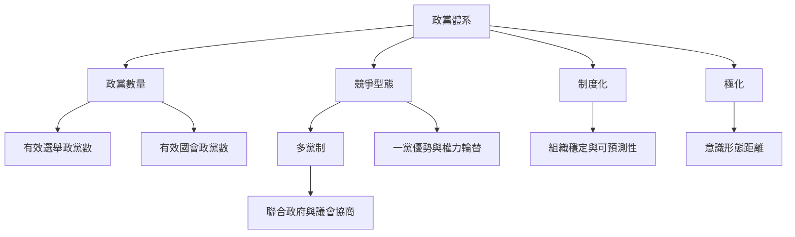

本圖把多黨制視為政黨體系的一種競爭形式，並將「數量」「制度化」「極化」「權力競爭」分開。研究者先界定政黨體系，再選擇合適的數量與品質指標，避免單一指標取代民主評估。

從[[政黨體系應依相關政黨與競爭關係分類]]開始，再閱讀[[多黨制描述的是政黨競爭結構而不是民主品質]]、[[政黨體系制度化讓競爭結果更可預測但不應僵化]]與[[政黨體系極化描述政治立場距離而非單純政黨數量]]。量化部分可搭配[[有效選舉政黨數]]與[[有效國會政黨數]]。

這個分析也與[[多黨制不等於多黨勢均力敵或真正的權力競爭]]所討論的概念互相補充。

這個分析也與[[政黨體系是政黨之間持續互動所形成的競爭秩序]]所討論的概念互相補充。

這個分析也與[[評估多黨民主時應把公平競爭與政權輪替列為核心指標]]所討論的概念互相補充。

這個分析也與[[共識民主]]所討論的概念互相補充。

這個分析也與[[政黨體系極化]]所討論的概念互相補充。

這個分析也與[[政黨體系]]所討論的概念互相補充。

這個分析也與[[比例代表制]]所討論的概念互相補充。

這個分析也與[[並立制]]所討論的概念互相補充。

這個分析也與[[政黨門檻]]所討論的概念互相補充。

這個分析也與[[社會分歧]]所討論的概念互相補充。

這個分析也與[[選前結盟]]所討論的概念互相補充。

這個分析也與[[聯合政府]]所討論的概念互相補充。

這個分析也與[[選區規模]]所討論的概念互相補充。

這個分析也與[[政黨體系制度化]]所討論的概念互相補充。

這個分析也與[[多黨制]]所討論的概念互相補充。

這個分析也與[[杜瓦傑定律]]所討論的概念互相補充。

這個分析也與[[總統制]]所討論的概念互相補充。

這個分析也與[[單一選區相對多數制]]所討論的概念互相補充。

這個分析也與[[聯立制]]所討論的概念互相補充。

這個分析也與[[政黨體系崩解]]所討論的概念互相補充。

這個分析也與[[少數政府]]所討論的概念互相補充。
## 思與行
* 先定義政黨體系，再決定要用哪些測量指標。
* 每次比較國家時，同時描述政黨數量、權力集中、制度穩定與極化。
* 與[[選舉制度如何塑造政黨競爭概念地圖]]及[[聯合政府與民主治理概念地圖]]共同閱讀。

## 參考
* Sartori（1976），[Parties and Party Systems](https://search.worldcat.org/title/Parties-and-party-systems-%3A-a-framework-for-analysis/oclc/2136976)。
* [[政黨體系制度化需要同時觀察組織穩定與競爭可預測性]]。
* 全書脈絡：[[Multi-party_system]]。
