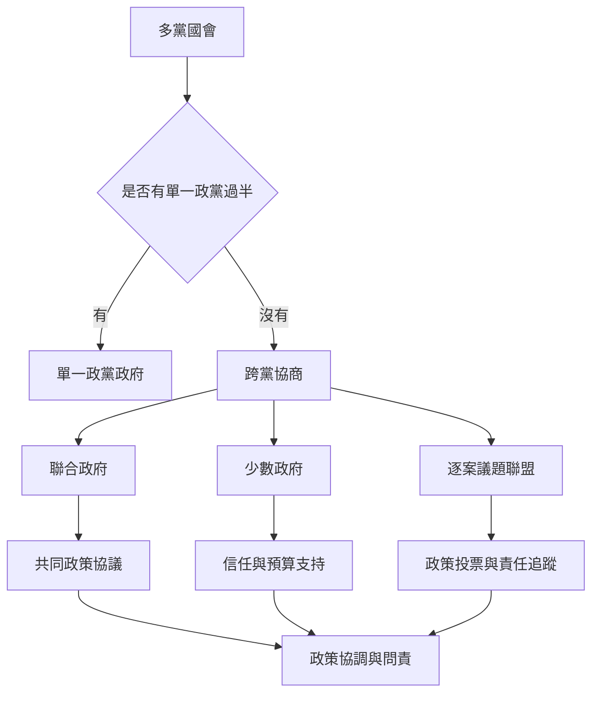

多黨國會不只改變席次分配，也改變政府形成、政策協商與責任歸屬。無單一政黨過半時，政黨可能組成正式聯合政府、支持少數政府，或依議題形成不同投票聯盟。

[[聯合政府是多個政黨透過協議共同承擔行政權力]]與[[少數政府可以透過跨黨支持協議取得執政空間]]是兩種不同安排。它們受到[[政黨體系極化描述政治立場距離而非單純政黨數量]]、政黨紀律與憲政制度影響。

這個概念也與[[總統制與多黨制的組合會增加協商與僵局風險]]所討論的問題相互連結。

這個分析也與[[瑞典組閣談判的 37 場訪談揭示政黨領袖如何協商]]所討論的概念互相補充。

這個分析也與[[比例代表與共識民主的績效應以多種民主結果衡量]]所討論的概念互相補充。

這個分析也與[[紐西蘭國會議員訪談呈現 MMP 改革後的政治實務經驗]]所討論的概念互相補充。

這個分析也與[[台灣立法院黨團協商研究結合立委訪談與幕僚問卷]]所討論的概念互相補充。

這個分析也與[[政黨體系核心概念地圖]]所討論的概念互相補充。

這個分析也與[[選前結盟能讓單一選區制中的小黨透過合作取得影響力]]所討論的概念互相補充。

這個分析也與[[共識民主透過權力分享降低贏者全拿的風險]]所討論的概念互相補充。

這個分析也與[[比較同一國家的選前聯盟與選後聯盟能看見協商時點的差異]]所討論的概念互相補充。

這個分析也與[[建立議題型公民協商平台補足政黨代表的不足]]所討論的概念互相補充。
## 思與行
* 將聯合協議、議會投票、預算與政策成果連結起來。
* 研究總統制國家時，額外檢查[[總統制]]與多黨國會間的權力關係。
* 推動[[聯合政府協議應公開政策承諾與爭端處理機制]]。

## 參考
* Laver & Schofield（1998），[Multiparty Government](https://press.umich.edu/Books/M/Multiparty-Government)。
* Mainwaring（1993），[Presidentialism, Multipartism, and Democracy](https://doi.org/10.1177/0010414093026002003)。
* 全書脈絡：[[Multi-party_system]]。
