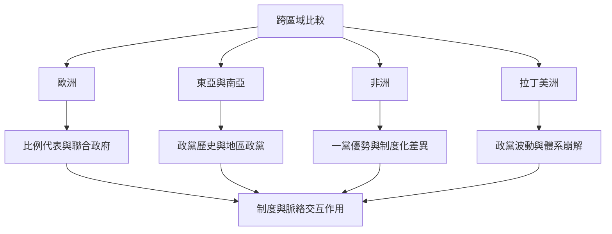

多黨政治沒有單一全球模型。選舉制度、憲政體制、政黨組織、社會分歧、殖民歷史、聯邦結構與民主化路徑彼此作用，形成不同的競爭結果。比較研究應以國家與時期為單位，不以洲別標籤取代脈絡分析。

案例可從[[紐西蘭的 MMP 改革顯示選制會重塑政黨與組閣慣例]]、[[台灣 2024 年立法院結果呈現三黨不過半而非簡單兩黨制]]、[[印度說明單一選區制也可能與多黨聯盟並存]]、[[非洲多黨選舉不必然形成穩定且可競爭的政黨體系]]及[[拉丁美洲的政黨體系崩解提醒穩定性不是民主的自然產物]]開始。

這個概念也與[[2026 年政黨體系綜述強調制度社會歷史因素必須合併分析]]所討論的問題相互連結。

這個概念也與[[日本的選制改革改變政黨競爭誘因但未完全消除舊政治慣例]]所討論的問題相互連結。

這個概念也與[[德國 2025 年聯邦選舉呈現門檻與多黨國會的雙重作用]]所討論的問題相互連結。

這個分析也與[[烏干達地方領袖訪談揭示多黨制度下反對黨的組織困境]]所討論的概念互相補充。

這個分析也與[[南非權力分享個案以參與者訪談記錄聯合治理的困難]]所討論的概念互相補充。

這個分析也與[[以色列的全國單一選區比例代表制容易產生高度政黨碎片化]]所討論的概念互相補充。

這個分析也與[[巴西案例顯示碎片化總統制政黨組織具有多層次特徵]]所討論的概念互相補充。

這個分析也與[[南非 2024 年選舉標誌 ANC 長期國會多數的終結]]所討論的概念互相補充。

這個分析也與[[社會分歧會透過政黨組織與選區分布影響多黨競爭]]所討論的概念互相補充。

這個分析也與[[以台灣 2024 年國會建立逐案投票聯盟資料集]]所討論的概念互相補充。
## 思與行
* 每一個案例至少納入官方選舉資料與一篇學術研究。
* 將同一國家的政黨體系放入時間序列，不將某一次選舉當成永久分類。

## 參考
* Tabassum（2026），[Theories on Variations in Party System](https://doi.org/10.1007/s11115-026-01046-9)。
* International IDEA 選制資料庫。
* 全書脈絡：[[Multi-party_system]]。
