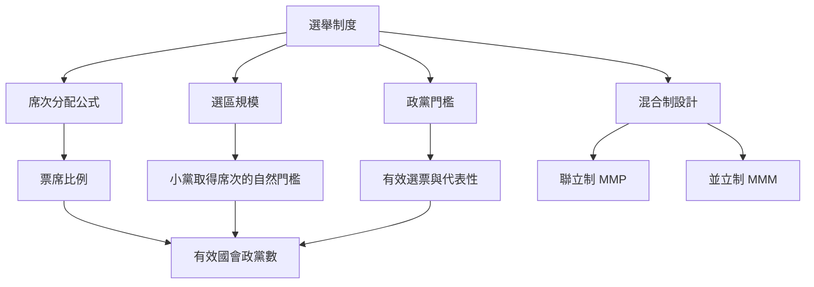

此圖將選舉制度視為一組影響政黨與選民策略的規則，而非決定政黨體系的唯一原因。選區規模、議會規模、門檻與席次公式共同影響票席比例；行為者也會因預期結果而改變提名、結盟與投票。

閱讀路徑可從[[選制透過機械效果與心理效果共同改變政黨競爭]]開始，再比較[[比例代表制提高小黨取得代表席次的機會但仍受門檻限制]]、[[聯立制以比例代表層補償單一選區造成的席次偏差]]與[[並立制將單一選區與政黨名單席次分開計算]]。跨國資料可參照[[國際 IDEA 資料庫提供跨 217 個國家與地區的選制比較基礎]]。

這個分析也與[[選舉制度會影響政黨數量但效果取決於社會與政治脈絡]]所討論的概念互相補充。

這個分析也與[[政黨體系核心概念地圖]]所討論的概念互相補充。

這個分析也與[[選區規模與議會規模會改變小黨取得席次的可能性]]所討論的概念互相補充。

這個分析也與[[選舉門檻在降低碎片化與排除選民之間形成取捨]]所討論的概念互相補充。

這個分析也與[[用互動式選制桌遊讓公民體驗不同規則如何改變結果]]所討論的概念互相補充。

這個分析也與[[模擬不同選舉門檻可以讓制度取捨變得可檢驗]]所討論的概念互相補充。
## 思與行
* 以同一組選票模擬不同制度，區分機械效果與行為效果。
* 用台灣、日本、紐西蘭與德國比較混合選制的差異。

## 參考
* Duverger（1954）；Benoit（2006）；International IDEA 選制資料庫。
* [[建立跨國政黨體系儀表板同時呈現席次代表性與競爭品質]]。
* 全書脈絡：[[Multi-party_system]]。
