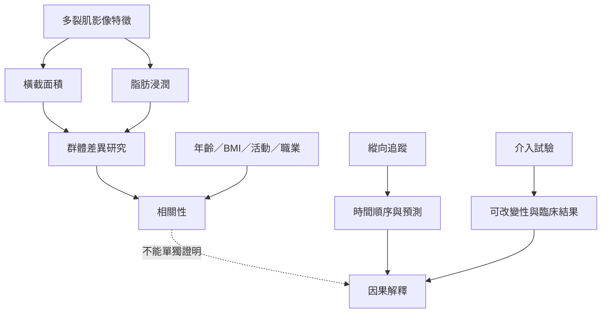

多裂肌脂肪浸潤與功能性橫截面積變化，是腰痛研究的重要主題；但不同研究設計會回答不同問題。橫斷面與統合分析描述群體差異，縱向研究檢驗預測，介入研究評估改變肌肉或動作策略後的結果。

## 思與行
* 先辨認研究設計，再判斷作者能否支持因果主張。
* 保留反例：丹麥九年追蹤未發現穩定預測未來腰痛的結果，是理解不確定性不可或缺的一部分。

## 參考
* [[data/多裂肌脂肪浸潤與成人下背痛有關但因果方向未明]]、[[data/丹麥九年世代研究未發現多裂肌脂肪浸潤能穩定預測未來腰痛]]、[[data/2025至2026年統合分析顯示慢性腰痛族群多裂肌品質變化較一致]]。
* [[note/多裂肌脂肪浸潤與腰痛的關聯不能直接解讀成因果]]、[[note/評估多裂肌時肌肉品質可能比單看尺寸更有資訊]]。
* [[idea/建立肌肉影像與症狀之間的因果檢核表]]。
* 根目錄：[[Multifidus_muscle|本書導讀]]
