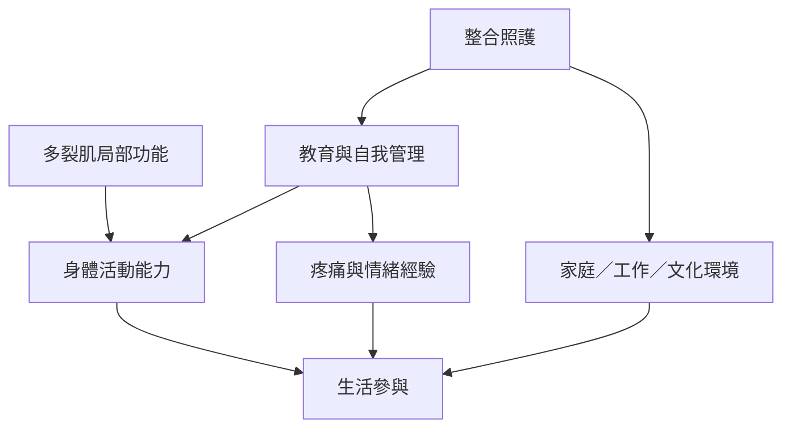

多裂肌的結構與控制值得研究，但慢性腰痛並非單一肌肉問題。跨國患者經驗、WHO 指南與復健研究提醒我們，身體功能、心理狀態、社會支持與生活參與都應被放進照護框架。

## 思與行
* 在科普與患者教育中，說明多裂肌的重要性時避免製造恐懼或把影像異常等同脊柱脆弱。
* 讓患者自己定義有意義的復原目標，並依照症狀與生活情境調整策略。

## 參考
* [[data/不同國家的腰痛患者都把疼痛經驗放在生活功能與社會關係中理解]]、[[data/世界衛生組織建議慢性原發性腰痛採取整合且以人為本的照護]]、[[data/美國疼痛醫學會將多裂肌神經刺激納入特定難治型腰痛的臨床討論]]。
* [[note/多裂肌研究不能取代患者對疼痛與生活的描述]]、[[note/不同治療技術必須依患者表型與風險比較]]。
* [[idea/比較不同文化中的穩定訓練語言如何影響身體經驗]]。
* [[term/國際健康功能分類（International Classification of Functioning, Disability and Health）]]、[[term/低背痛（Low back pain）]]、[[term/復健（Rehabilitation）]]。
* 根目錄：[[Multifidus_muscle|本書導讀]]
