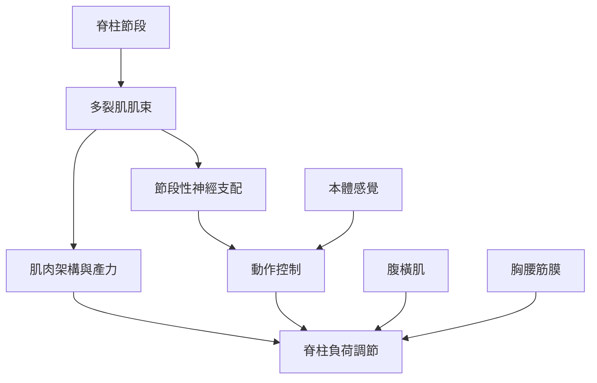

多裂肌不是孤立的「核心肌肉」，而是位於橫突棘突肌群中的深層節段性構造。理解它需要從解剖附著、肌束方向、肌肉架構、神經支配與脊柱負荷一起閱讀。

## 思與行
* 由骨性附著與肌束方向開始，再閱讀肌肉如何在不同動作中工作。
* 把局部控制與整體協調並置，不把「穩定」理解成固定不動。

## 參考
* [[data/腰椎多裂肌的肌束具有分層且節段性的形態]]、[[data/多裂肌的短肌束架構有利於產生脊柱穩定力]]、[[data/日本2026年解剖研究重新檢視腰椎多裂肌附著結構]]。
* [[note/多裂肌的節段性構造支持局部控制但不代表單一肌束能獨立工作]]、[[note/多裂肌的穩定功能來自架構與神經控制的共同作用]]。
* [[term/多裂肌（Multifidus muscle）]]、[[term/橫突棘突肌群（Transversospinales）]]、[[term/節段穩定（Segmental stability）]]、[[term/本體感覺（Proprioception）]]。
* [[idea/把多裂肌從單一核心肌肉重新理解為感覺與動作網絡的一部分]]。
* 根目錄：[[Multifidus_muscle|本書導讀]]
