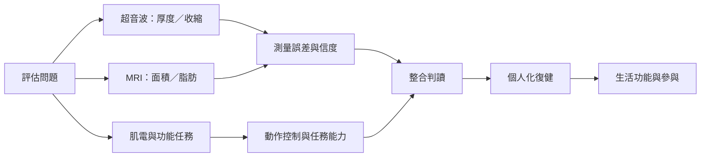

超音波、MRI、肌電與功能測試各自能觀察多裂肌的不同層面。復健則涉及疼痛、失能、肌肉形態、動作學習與日常功能。單一工具或單一指標不足以代表整體復原。

## 思與行
* 依研究問題選擇工具，不用 MRI 回答動作控制問題，也不用肌肉厚度代替生活功能。
* 把生物回饋逐步轉移到自主動作與日常任務。

## 參考
* [[data/台灣研究支持腰椎多裂肌深淺層超音波厚度測量的跨日可靠性]]、[[data/超音波可可靠測量多裂肌厚度但收縮狀態會影響測量一致性]]、[[data/奈及利亞隨機試驗顯示穩定運動合併超音波回饋可改善多項腰痛結果]]。
* [[note/超音波能觀察多裂肌但結果高度依賴測量流程]]、[[note/超音波回饋可協助動作學習但最終目標是自主控制]]、[[note/局部肌肉訓練應放進漸進且功能導向的復健脈絡]]。
* [[idea/把超音波回饋設計成逐步撤除的學習支架]]、[[idea/把復原追蹤從疼痛分數擴展到日常功能與活動能力]]。
* 根目錄：[[Multifidus_muscle|本書導讀]]
