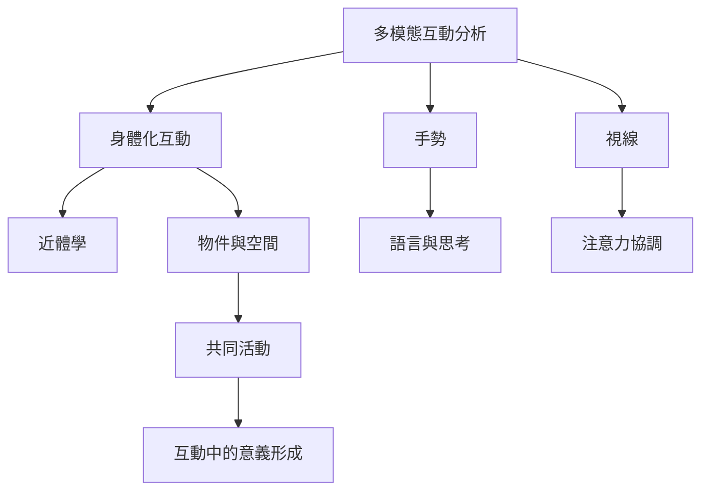

互動不是語言句子的交換，而是人們透過身體、視線、手勢、物件與空間共同完成活動。此圖將互動分析的微觀序列與身體化、空間化的情境資源連在一起。

概念節點：[[多模態互動分析]]、[[身體化互動]]、[[手勢]]、[[視線]]、[[近體學]]、[[節奏與時序]]。

研究連結：[[多模態互動分析應記錄語言手勢視線與物件]]、[[多模態會話分析追蹤身體與物件如何組織行動]]、[[互動中的身體物質性與多感官性不可分開]]、[[香港 EMI 課堂透過多語與多模態資源管理互動]]。

* 本書導讀：[[Multimodality]]
