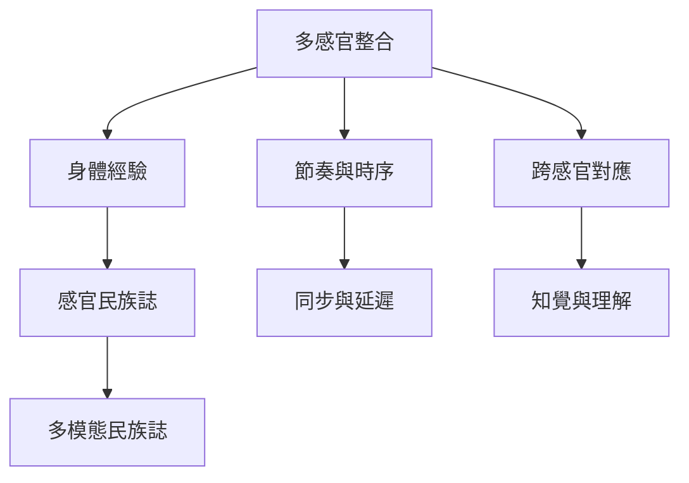

多感官研究關注視覺、聽覺、觸覺與其他感官線索如何在時間和情境中整合。符號模式與感官通道並非同一概念，但在具體活動中會彼此交織。

概念節點：[[多感官整合]]、[[跨感官對應]]、[[節奏與時序]]、[[感官民族誌]]、[[多模態民族誌]]。

研究連結：[[多感官整合研究連結知覺認知與溝通]]、[[跨感官時間知覺不只發生於視聽通道]]、[[互動中的身體物質性與多感官性不可分開]]。

* 本書導讀：[[Multimodality]]
