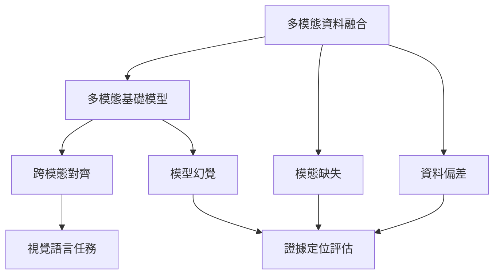

計算領域中的多模態，通常指模型接收或整合不同資料型態。融合策略可帶來互補資訊，也會引入模態缺失、資料偏差、分布轉移與幻覺。模型的跨模態對齊應透過證據定位與反例測試評估。

概念節點：[[多模態資料融合]]、[[多模態基礎模型]]、[[跨模態對齊]]、[[模型幻覺]]。

研究連結：[[醫療多模態資料融合整合影像病歷與結構化資料]]、[[多模態基礎模型仍受領域落差與少樣本適應限制]]、[[視覺語言大型模型可能把資料共現誤當成視覺證據]]。

* 本書導讀：[[Multimodality]]
