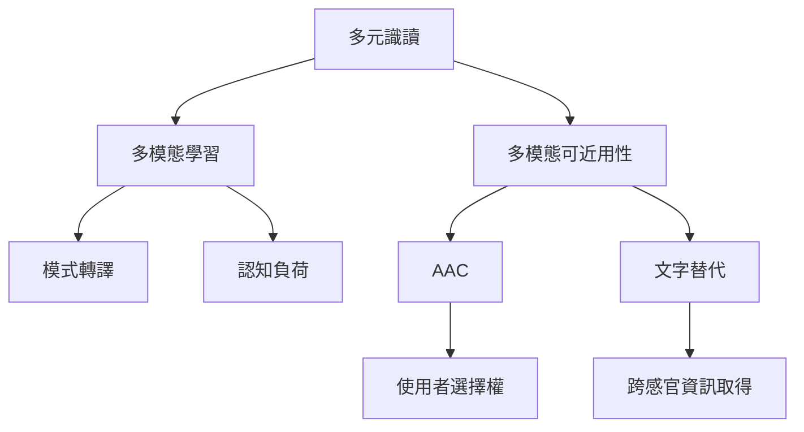

教育與可近用設計共同處理一個問題：不同的人如何透過不同模式取得資訊、表達理解並參與活動。多模態教學要兼顧學習目標與認知負荷；可近用設計則要求提供替代通道與溝通工具。

概念節點：[[多元識讀]]、[[多模態學習]]、[[多模態可近用性]]、[[輔助與替代溝通]]、[[節奏與時序]]。

研究連結：[[多元識讀回應語言文化與媒介多樣化]]、[[南非課堂多模態教學擴大兒童的參與與能動性]]、[[非文字內容應提供可轉換為多種感官形式的替代資訊]]、[[AAC 讓溝通者混用手勢圖像文字與語音科技]]。

* 本書導讀：[[Multimodality]]
