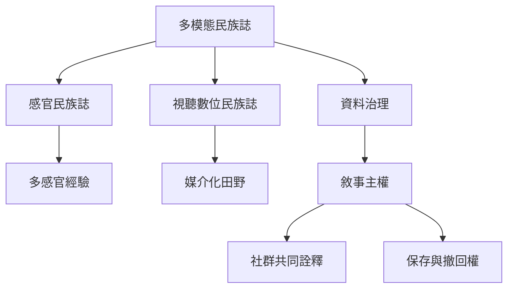

多模態民族誌把研究方法、感官經驗和資料治理放在一起。影像、聲音、地圖、口述與身體實作能保存不同知識，但媒介也會改變可見性、代表權與資料控制。地方社群應能參與選擇、詮釋與保存自身故事。

概念節點：[[感官民族誌]]、[[多模態民族誌]]、[[敘事主權]]、[[媒介]]、[[多模態可近用性]]。

研究連結：[[多模態人類學方法必須同時處理方法與數位落差倫理]]、[[地方社群媒體可在外部平台上維持敘事主權]]、[[拉丁美洲原住民族語言景觀承載文化與政治流動]]。

* 本書導讀：[[Multimodality]]
