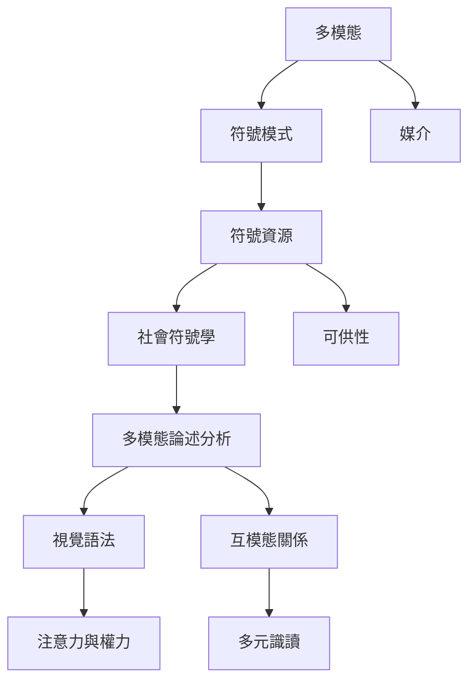

多模態符號研究的核心問題，是社會成員如何選擇並組織不同符號資源，以完成表達、說服、識讀與身份建構。這張地圖從模式、媒介、符號資源和可供性出發，連到視覺語法、互模態關係與權力分析。

概念節點：[[多模態]]、[[符號模式]]、[[媒介]]、[[符號資源]]、[[社會符號學]]、[[可供性]]、[[多模態論述分析]]、[[視覺語法]]、[[互模態關係]]、[[多元識讀]]。

研究連結：[[多模態研究首先研究意義資源如何整合而非只數算媒介]]、[[圖像語法揭示構圖如何安排觀看者與權力]]、[[社會符號學把多模態視為日常溝通的整體編排]]、[[印度電視廣告以跨模態設計協商全球與地方身份]]、[[新加坡馬來西亞招牌展示文字圖像與物件的創意組合]]。

* 本書導讀：[[Multimodality]]
