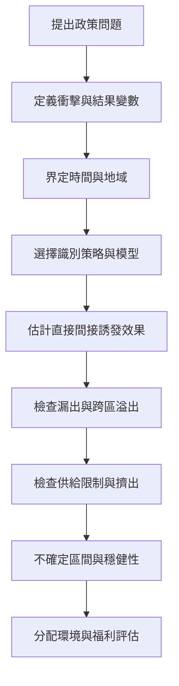

本圖把文獻閱讀轉化成可以重複使用的檢查流程。估計值只有在研究對象、衝擊識別、時間窗口、地理範圍與政策制度清楚時，才具有比較意義。

方法入口：[[乘數估計首先要說明分子分母與時間區間]]、[[乘數是條件化的傳導機制而不是固定倍率]]、[[乘數數字不能取代福利分配與環境評估]]。

研究入口：[[拉丁美洲各國的財政乘數會隨識別方法與總體條件變動]]、[[中國地方乘數取決於財政分權與地方制度誘因]]、[[撒哈拉以南非洲的財政緊縮效果受國別與景氣條件影響]]、[[照護與綠色投資能創造乘數但產業與性別效果並不相同]]。

建議每個數字附上樣本期、政策工具、估計方法與限制，不建立脫離脈絡的全球乘數排行榜。

總導讀：[[Multiplier_(economics)]]。
