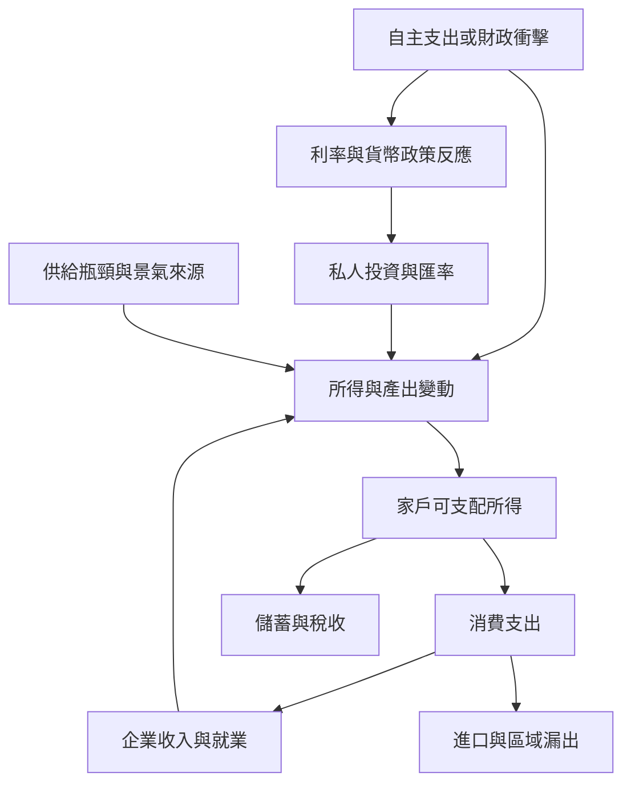

本圖聚焦總體需求與財政政策如何形成乘數，以及哪些條件會改變傳導。核心不是把所有情境歸納成一個固定倍率，而是看收入回流、漏出、擠出與政策制度如何互相作用。

閱讀時可從[[凱因斯支出乘數]]、[[邊際消費傾向]]、[[稅收乘數]]、[[平衡預算乘數]]開始，再看[[財政乘數]]、[[狀態依賴乘數]]與[[擠出效果]]。

實證脈絡：[[凱因斯乘數從就業與投資的連鎖關係發展而來]]、[[美國歷史資料不支持衰退時政府支出乘數必然大於一]]、[[歐洲危機經驗顯示財政緊縮可能帶來更大的短期產出損失]]、[[財政乘數的估計值會隨識別方法與模型假設改變]]。

延伸問題：[[財政與貨幣政策的組合會改變支出乘數]]、[[財政乘數大小取決於景氣來源而不只是景氣高低]]。

總導讀：[[Multiplier_(economics)]]。
