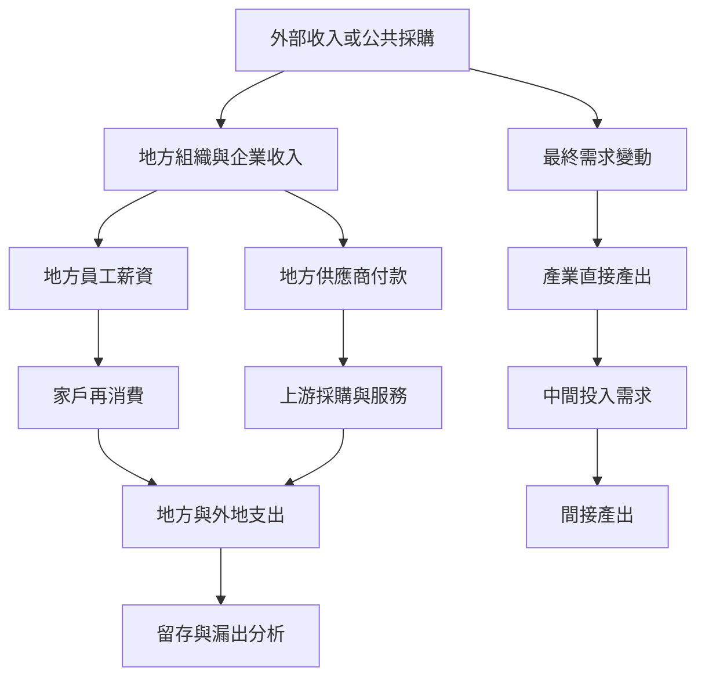

本圖區分地方金流循環與產業供應鏈推算。地方經濟乘數重點在地理邊界內的收入留存；投入產出乘數則依產業技術係數推算直接和間接產出。兩者可互補，但測量目的不同。

概念入口：[[地方經濟乘數]]、[[地方財政乘數]]、[[投入產出乘數]]、[[里昂惕夫逆矩陣]]、[[誘發效果]]、[[區域經濟漏出]]、[[跨區域溢出]]。

實證與方法：[[地方乘數應追蹤採購與所得的在地再支出]]、[[投入產出乘數可能高估專案對區域經濟的淨貢獻]]、[[觀光收入的進口與企業採購漏出會削弱目的地乘數]]、[[日本地方政府支出會透過區域內需求與跨區溢出影響產出]]。

設計提醒：地方邊界、供應商實際生產地、員工居住地與進口投入都應明確定義。

總導讀：[[Multiplier_(economics)]]。
