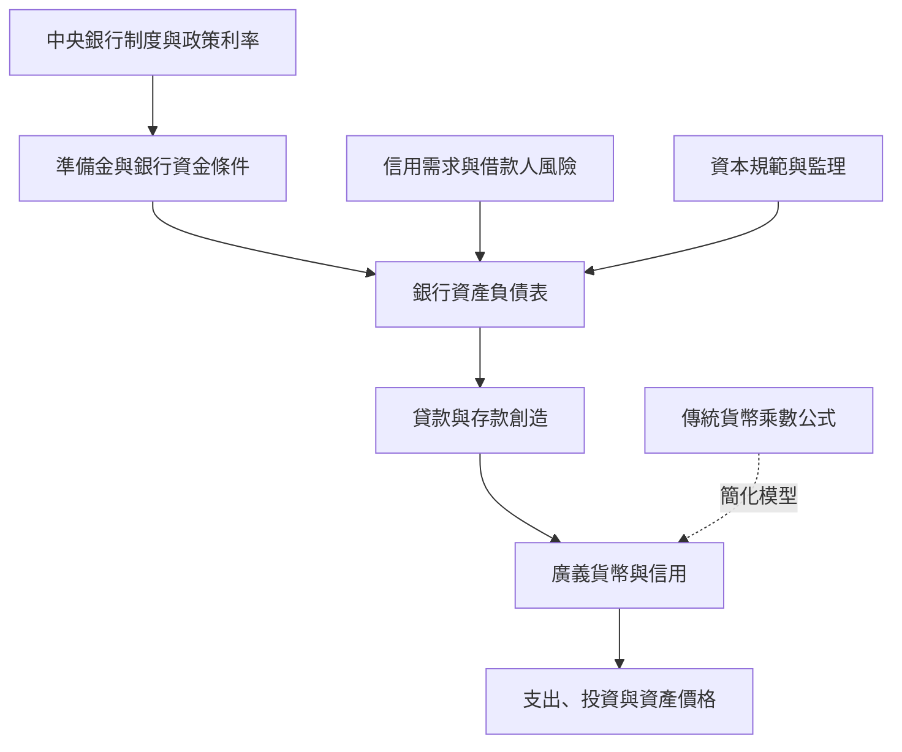

本圖說明傳統貨幣乘數的概念，以及現代銀行放款並非單靠準備金固定倍增的理由。貨幣乘數與支出乘數名稱相近，但傳導機制不同。

概念入口：[[貨幣基數]]、[[貨幣乘數]]、[[經濟乘數]]、[[凱因斯支出乘數]]、[[擠出效果]]。

實證提醒：[[現代銀行信用創造不能簡化為準備金固定倍增存款]]；分析各國時還要辨認中央銀行操作框架與銀行監理制度。

總導讀：[[Multiplier_(economics)]]。
