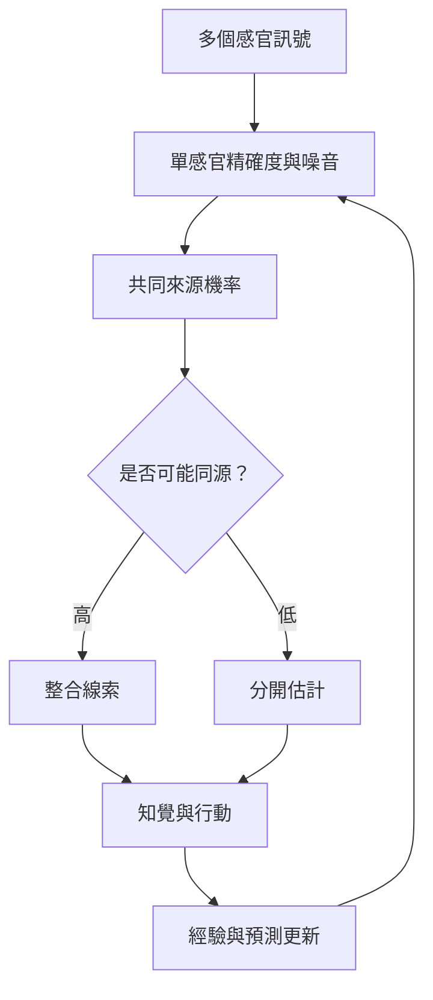

多感官知覺可理解為一個連續的推論流程：先評估各通道訊號品質，再估計它們是否來自共同原因，最後依任務決定融合或分離，並在重複經驗中更新權重。這張地圖連結感官線索加權、最大概似估計、貝氏因果推論與預測處理。

概念連結：[[term/多感官整合]]、[[term/感官線索加權]]、[[term/最大概似估計]]、[[term/貝氏因果推論]]、[[term/預測處理]]。

延伸閱讀：[[note/感官權重會隨線索可靠度動態調整]]、[[note/感官整合需要在融合與分離之間彈性切換]]、[[note/測量表現不能單獨代表多感官整合能力]]。
