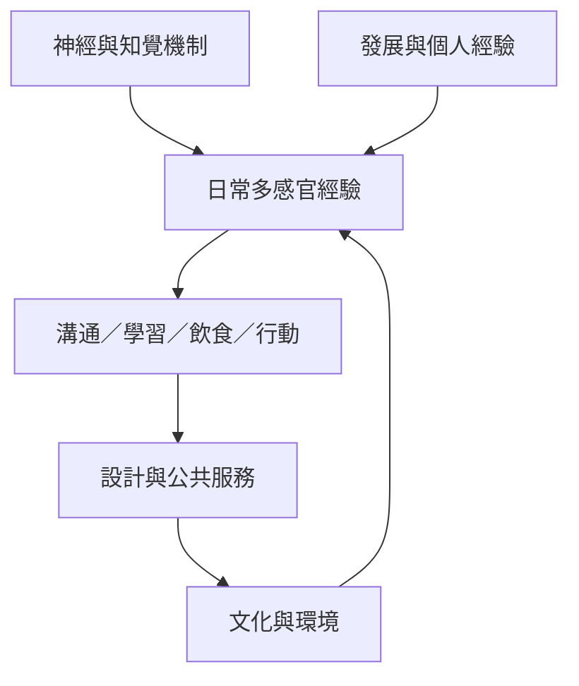

多感官整合研究不應停留在實驗室中的神經機制。語言溝通、飲食、學習、輔具、地方感與公共空間都涉及感官如何組合。神經計算研究解釋可能機制；感官民族誌則補充感覺如何在社會實踐與文化情境中獲得意義。

概念連結：[[term/感官民族誌]]、[[term/感官生態學]]、[[term/風味]]、[[term/多感官學習]]、[[term/感官替代]]。

延伸閱讀：[[note/感官經驗是身體文化與環境共同塑造的]]、[[note/實驗室效應必須放回自然互動情境檢驗]]、[[note/神經多樣性族群的感官差異不能簡化成單一缺陷]]。
