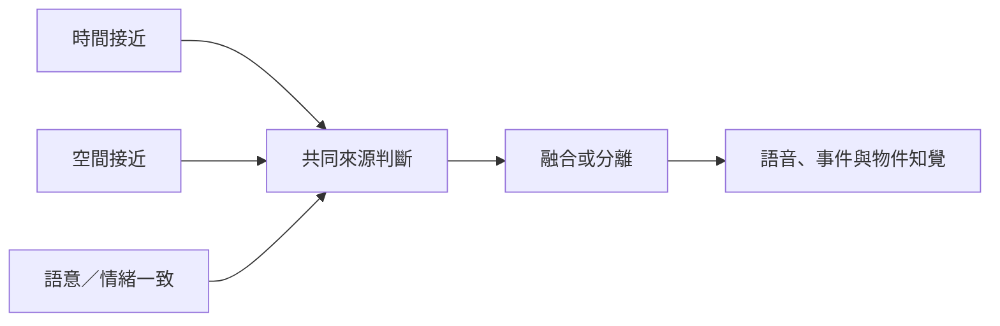

跨感官訊號是否被視為同一事件，取決於時間差、空間位置、刺激一致性、語意與情緒等線索。時間結合窗口描述可容許的時間差範圍；貝氏因果推論則解釋為何這些線索會改變共同來源判斷。

概念連結：[[term/時間結合窗口]]、[[term/貝氏因果推論]]、[[term/McGurk效應]]、[[term/視聽語音整合]]、[[term/跨感官對應]]。

延伸閱讀：[[note/時間與空間一致性提高共同來源的推論機率]]、[[note/社會溝通依靠語音面孔與手勢的協同]]、[[note/知覺同時依賴當下訊號與預測模型]]。
