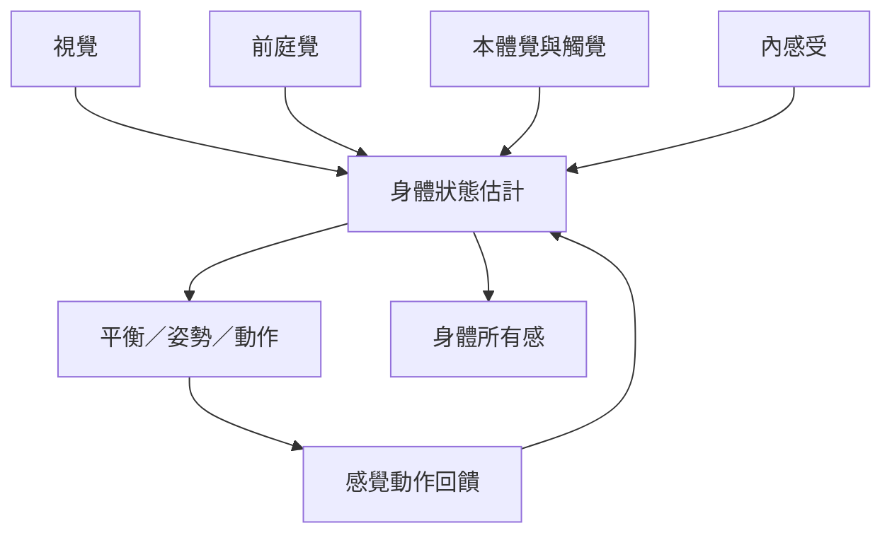

身體定位、平衡與身體所有感並非來自單一感官，而是多種身體訊號與預期的協調。視覺、前庭覺與本體覺共同支持姿勢與移動；內感受提供身體內部狀態線索。環境改變時，感官權重必須重新調整。

概念連結：[[term/本體覺]]、[[term/前庭覺]]、[[term/內感受]]、[[term/身體所有感]]、[[term/感官重加權]]。

延伸閱讀：[[note/身體所有感是多種感官與預期共同校準的結果]]、[[note/平衡控制仰賴視覺前庭與本體覺動態重加權]]。
