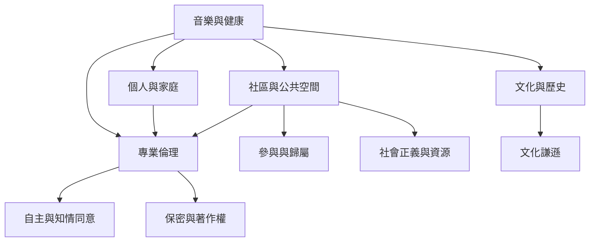

本地與國際社區案例顯示，音樂治療的專業責任不止於個案會談，也涉及文化脈絡、公共參與、作品權利與制度條件。此地圖把個人治療與社區實踐放在同一個生態系中觀察。

* 社區實務：[[社區音樂治療把健康理解為關係與參與的生態現象]]。
* 文化倫理：[[文化謙遜要求治療師持續檢查自己的文化假設]]。
* 作品權利：[[當事人的音樂創作需要受到著作權與知情同意保護]]。
* 制度比較：[[音樂治療專業的形成受到各地制度與文化歷史塑造]]。

## 雙向連結
* [[社區音樂治療]]、[[文化謙遜]]、[[音樂治療倫理]]、[[治療關係]]
* [[音樂治療的介入必須回應個人與社群的脈絡]]、[[在社區共餐與閱讀聚會中加入自願式聲音共創]]
