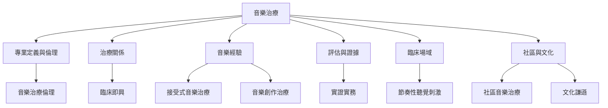

本概念地圖把音樂治療視為一個由專業定義、治療關係、音樂經驗、評估方法與倫理責任組成的知識網絡。先釐清專業邊界，再理解介入媒介，最後把臨床與社區實務放回文化和制度脈絡。

核心閱讀可由 [[世界音樂治療聯盟於2026年擴大音樂治療的全球定義]] 開始，接著閱讀 [[音樂治療是一門兼具藝術與健康照護責任的專業]]、[[音樂治療與音樂醫學必須分開描述]]，再進入 [[音樂治療需要評估目標與持續回饋形成完整流程]]。

## 雙向連結
* [[音樂治療]]、[[音樂醫學]]、[[治療關係]]、[[實證實務]]、[[音樂治療倫理]]
* [[臨床即興]]、[[接受式音樂治療]]、[[音樂創作治療]]、[[社區音樂治療]]
* [[失智照護中的音樂應優先支持情緒參與與連結]]、[[神經多樣性取向應把自主參與與福祉放在中心]]
