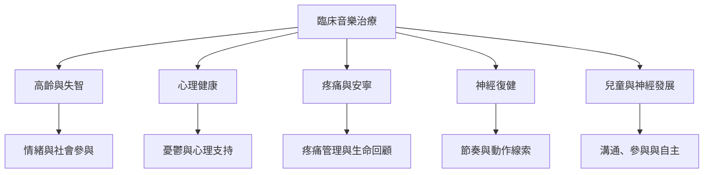

此地圖依服務目標與場域整理研究，不把診斷直接等同介入方案。不同族群需要不同評估指標、音樂經驗和跨專業合作方式。

* 高齡與失智：[[失智照護中的音樂應優先支持情緒參與與連結]]。
* 心理健康：[[2025年憂鬱症音樂治療統合分析呈現正向結果但證據確定性很低]]。
* 慢性疼痛：[[2025年慢性疼痛音樂治療回顧顯示疼痛與憂鬱可能改善]]。
* 安寧照護：[[安寧音樂治療需要持續評估而非套用固定曲目]]。
* 中風復健：[[節奏提示可把時間結構轉化為動作線索]]。
* 自閉症支持：[[神經多樣性取向應把自主參與與福祉放在中心]]。

## 雙向連結
* [[音樂治療成效評估]]、[[實證實務]]、[[跨專業合作能讓音樂介入連接日常功能]]
* [[音樂治療效果必須依族群目標與時間尺度判讀]]
