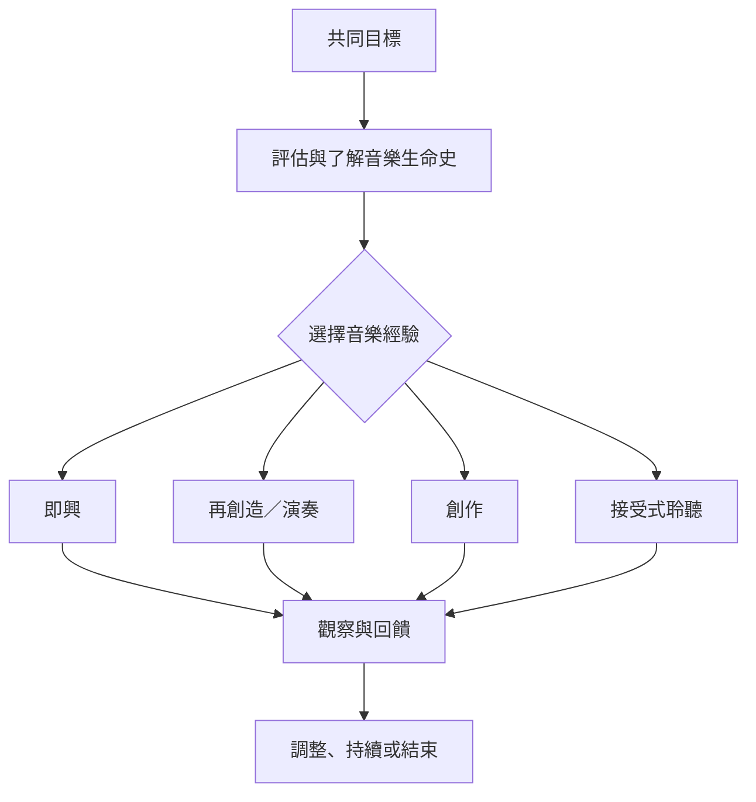

音樂經驗是治療媒介，治療歷程則決定如何選擇、調整與評估媒介。四種常見經驗可交錯運用，並且都必須保留當事人的選擇權。

* 治療歷程：[[音樂治療需要評估目標與持續回饋形成完整流程]]。
* 介入選擇：[[音樂治療的四種基本音樂經驗提供不同參與入口]]。
* 即時互動：[[臨床即興讓治療關係在聲音中即時成形]]。
* 聆聽自主：[[接受式音樂治療也需要主動的聆聽與選擇]]。
* 個人化素材：[[以個人音樂生命史建立更貼近當事人的選曲地圖]]。

## 雙向連結
* [[治療關係]]、[[臨床即興]]、[[接受式音樂治療]]、[[音樂創作治療]]、[[音樂生命史]]、[[音樂治療成效評估]]
